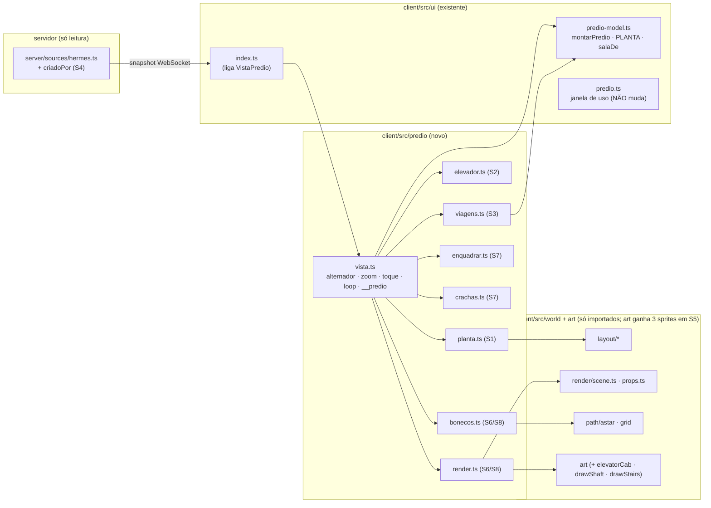
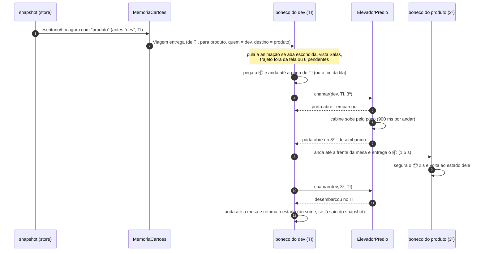
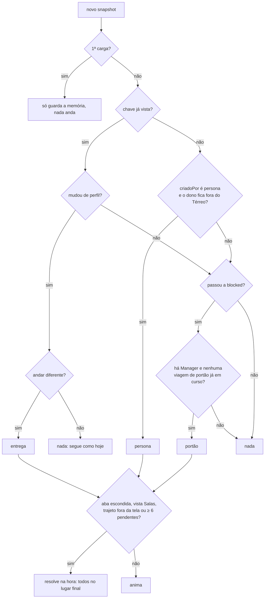

# Fluxos e arquitetura do prédio vertical

## Módulos (o que é novo e o que só é importado)

## Uma viagem de entrega (o cartão passa do dev da TI para o Produto)

Variações: **portão** (o Manager sobe com papéis até a Mesa do Victor, 4 s, volta), **persona** (sai da Recepção
com o 📦, entrega, volta), **📦 sozinho** (`quem = null`: a caixa viaja na cabine e quem recebe busca na porta).

## O que dispara cada viagem

## Cabine (máquina de estados de `elevador.ts`)

```mermaid
stateDiagram-v2
  [*] --> Parada
  Parada --> Abrindo: alguém desce aqui ou espera aqui
  Parada --> Movendo: chamada noutro andar
  Abrindo --> Aberta: 450 ms
  Aberta --> Aberta: desce quem tem este destino (300 ms cada),<br/>depois embarca a fila até 3
  Aberta --> Fechando: 650 ms sem movimento
  Fechando --> Abrindo: chegou alguém na porta antes de fechar
  Fechando --> Parada: 450 ms, sem ninguém pedindo
  Fechando --> Movendo: 450 ms, há próxima parada
  Movendo --> Abrindo: chegou à próxima parada (mesmo sentido; sem nenhuma, inverte)
```

